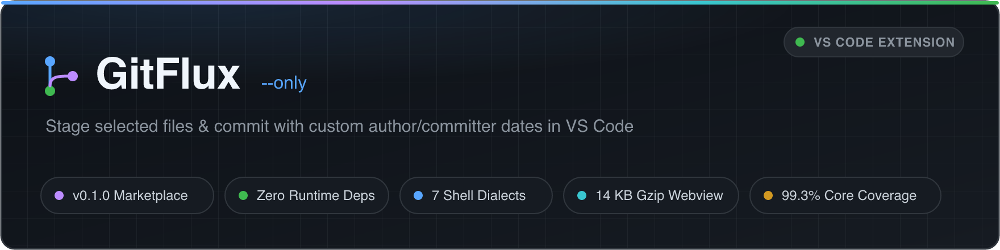
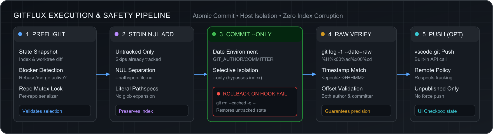
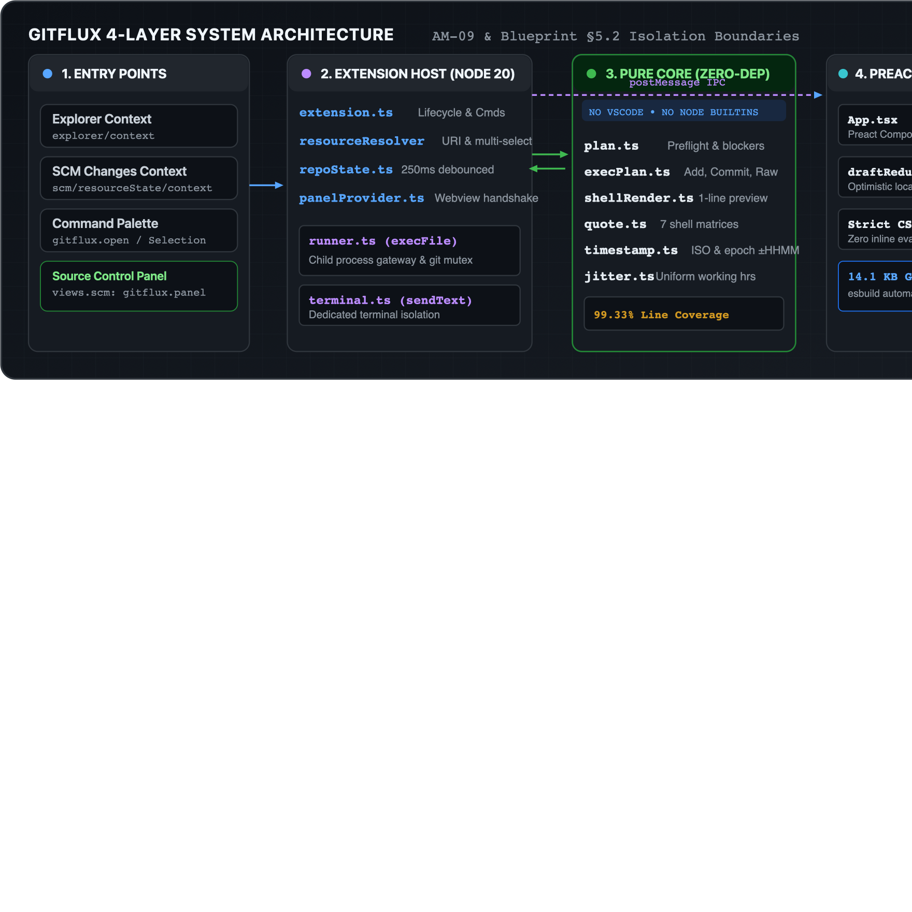

<div align="center">



<br/>

[](https://marketplace.visualstudio.com/items?itemName=advaetuc.gitflux)
[](https://marketplace.visualstudio.com/items?itemName=advaetuc.gitflux)
[](https://github.com/advaetuc/GitFlux/actions)
[](LICENSE)
[](package.json)
[](package.json)

<p align="center">
  <b>A lightweight, secure, and production-grade VS Code extension to stage selected files and commit them with custom author/committer dates without touching unrelated staged changes.</b>
</p>

</div>

---

## Why GitFlux?
Missed a commit day on your GitHub streak—or forgot to commit before midnight? Use **GitFlux**.

Committing with historical or adjusted timestamps in Git is traditionally error-prone: CLI environment variables (`GIT_AUTHOR_DATE`, `GIT_COMMITTER_DATE`) are clunky, GUI tools alter all staged files at once, and simple scripts risk corrupting your index or accidentally amending pushed history.

**GitFlux** solves this cleanly inside VS Code:

- **Selective `--only` Pathspecs:** Stage only the exact files you choose from the Explorer or Source Control list. Any existing staged changes in your index remain 100% untouched and staged.
- **Bifurcated Author & Committer Timestamps:** Set both `GIT_AUTHOR_DATE` and `GIT_COMMITTER_DATE` simultaneously with second-level precision (`YYYY-MM-DDTHH:MM:SS`) and explicit timezone offsets (`±HHMM` from UTC−12:00 to UTC+14:00 or local system time).
- **Working-Hours Time Jitter:** Avoid suspicious, uniform timestamps with the built-in **Randomize within working hours** feature (configurable, default `09:30`–`18:30`).
- **Live Single-Line Shell Preview:** View the exact command that will execute, dynamically updated as you type and formatted for your chosen shell.
- **HEAD Date Amender (Unpublished Only):** Need to adjust the date of your latest local commit? Update author and committer dates on `HEAD` without altering commit messages, file trees, or pushing force-rewrites. If the commit is already published to a remote branch, GitFlux strictly blocks modification.
- **Zero Runtime Dependencies:** Zero external npm production dependencies (`dependencies: {}`). Fast activation, tiny memory footprint, and high auditability.

---

## Record Real Work on the Day You Did It

Git lets you set a commit's author and committer date. GitFlux makes that precise and safe for work that is real but was committed late: a fix finished on Friday and committed Monday, files from a branch of work you forgot to commit, or timestamps you need to correct.

**When GitHub counts a commit toward your contribution graph** (see [GitHub's troubleshooting guide](https://docs.github.com/en/account-and-profile/setting-up-and-managing-your-github-profile/managing-contribution-settings-on-your-profile/why-are-my-contributions-not-showing-up-on-my-profile)):
- The commit email is associated with your GitHub account.
- The repository is standalone, not a fork.
- The commit is on the default branch (or `gh-pages`).
- Days are bucketed in UTC, and a new commit can take up to 24 hours to appear.
- Private-repository activity shows only if you enable private contributions in your GitHub profile settings.

GitFlux does not bypass any of these rules. Use it to record work you actually did, not to misrepresent activity to others. GitFlux is not affiliated with GitHub.

---

## Execution & Safety Pipeline

<div align="center">
  
</div>

GitFlux provides three flexible execution modes with robust rollback safeguards:

### 1. Run Now (Direct Execution)
- Invokes Git directly using Node.js `child_process.execFile` with argument vectors. It never interpolates strings into a shell, completely eliminating shell injection risks.
- Untracked files are staged safely using `--pathspec-from-file=- --pathspec-file-nul` via `stdin` to handle special characters, spaces, and Unicode paths without command-length limits.
- The commit is created using `git --literal-pathspecs commit --only --cleanup=whitespace`.
- **Atomic Pre-Commit Rollback:** If a pre-commit hook fails or rejects the commit, GitFlux automatically triggers `git rm --cached -q --pathspec-from-file=- --pathspec-file-nul` to restore newly added untracked files to their clean unstaged state.
- **Raw Epoch Verification:** Immediately verifies the commit using `git log -1 --format="%H%x00%ad%x00%cd" --date=raw` to confirm both author and committer `<epoch> <±HHMM>` match the requested timestamp.

### 2. Copy Command
- Formats a single-line, shell-escaped command tailored to your active dialect and copies it to your clipboard with a single click.

### 3. Send to Terminal
- Sends the rendered command directly to a dedicated VS Code Integrated Terminal named `GitFlux: <repo-name>`.
- Guarded by a safety check: the action is disabled if the selected dialect does not match your active terminal profile.

---

## System Architecture

<div align="center">
  
</div>

GitFlux enforces strict 4-layer isolation boundaries per [AM-09 & Architecture Blueprint §5.2](docs/blueprint.md):

1. **Entry Points:** VS Code UI menus (`explorer/context`, `scm/resourceState/context`, Command Palette, and SCM View panel).
2. **Extension Host (Node 20):** Handles extension lifecycle, URI resolution (`resourceResolver.ts`), 250ms debounced repository state snapshots (`repoState.ts`), webview messaging handshake (`panelProvider.ts`), Git execution mutex (`runner.ts`), and terminal isolation (`terminal.ts`).
3. **Pure Core (Zero-Dep):** Pure TypeScript logic with zero dependencies, no access to VS Code APIs, and no Node.js built-ins. Contains plan generation (`plan.ts`), execution recipes (`execPlan.ts`), shell renderers (`shellRender.ts`), hostile vector quoting (`quote.ts`), and timestamp formatting (`timestamp.ts`).
4. **Preact Webview (<15 KB):** Sandboxed UI compiled with Preact and Codicons. Communicates with the host solely over typed `postMessage` protocol with a strict nonce-based Content Security Policy (`script-src 'nonce-...'`).

---

## Why Is This Safe?

- **Never rewrites pushed history:** Normal commits create new commits. The HEAD date amender refuses any commit already on a remote.
- **Never uses `--no-verify`, `--force`, or `--force-with-lease`:** Your Git hooks run normally, and a failed hook rolls back only the untracked files GitFlux itself staged.
- **Selective `--only` pathspecs:** Anything else you have staged in your index stays staged and uncommitted.
- **Zero runtime dependencies:** The extension host ships zero npm runtime dependencies, and the Preact webview bundle is ~14 KB gzipped.

---

## Installation

### From VS Code Marketplace
1. Open VS Code.
2. Press `Ctrl+P` (or `Cmd+P` on macOS) and run:
   ```bash
   ext install advaetuc.gitflux
   ```
3. Or search for **`GitFlux`** in the Extensions sidebar (`Ctrl+Shift+X` / `Cmd+Shift+X`).

### From Command Line
```bash
code --install-extension advaetuc.gitflux
```

### Manual VSIX Installation
Download the latest `.vsix` release from GitHub Releases and install via:
```bash
code --install-extension gitflux-0.2.2.vsix
```

---

## Configuration Reference

Customize GitFlux behavior in your VS Code User or Workspace Settings (`settings.json`):

| Setting Key | Type | Default | Description |
| :--- | :---: | :---: | :--- |
| `gitflux.shell` | `string` | `"auto"` | Preferred shell dialect for **Copy** and **Send to Terminal** (`auto`, `bash`, `zsh`, `sh`, `fish`, `pwsh`, `powershell`, `cmd`). `auto` detects your default terminal profile. |
| `gitflux.workingHours.start` | `string` | `"09:30"` | Start time for **Randomize within working hours** (24-hour `HH:MM`). |
| `gitflux.workingHours.end` | `string` | `"18:30"` | End time for **Randomize within working hours** (24-hour `HH:MM`). |
| `gitflux.push.defaultEnabled` | `boolean` | `false` | Whether the **Push after commit** checkbox starts checked by default. |
| `gitflux.terminal.autoRun` | `boolean` | `false` | Automatically press Enter after **Send to Terminal**. *Application-scoped* so malicious repository `.vscode/settings.json` files cannot enable it. |

---

## Shell Quoting & Rejection Matrix

GitFlux features dedicated quoting engines for 7 shell dialects, thoroughly validated across 18 hostile test vectors (including command substitutions, pipe injection, control characters, unicode, and escape sequences):

| Shell Dialect | Quoting Strategy | Single Quote (`'`) Handling | Double Quote (`"`) Handling | Trailing Backslash Fix | Rejected Unsafe Characters |
| :--- | :--- | :--- | :--- | :--- | :--- |
| **Bash** | Single-quote wrap | `'\''` escaping | Preserved verbatim | Preserved verbatim | Control characters (`\x00`–`\x1F`), U+202E |
| **Zsh** | Single-quote wrap | `'\''` escaping | Preserved verbatim | Preserved verbatim | Control characters (`\x00`–`\x1F`), U+202E |
| **POSIX sh** | Single-quote wrap | `'\''` escaping | Preserved verbatim | Preserved verbatim | Control characters (`\x00`–`\x1F`), U+202E |
| **Fish** | Single-quote wrap | `\'` escaping | Preserved verbatim | Preserved verbatim | Control characters (`\x00`–`\x1F`), U+202E |
| **PowerShell Core (`pwsh`)** | Single-quote wrap | `''` doubling | Preserved verbatim | Preserved verbatim | Control characters (`\x00`–`\x1F`), U+202E |
| **Windows PowerShell (5.1)** | Single-quote wrap | `''` doubling | Preserved verbatim | Preserved verbatim | Control characters (`\x00`–`\x1F`), U+202E |
| **cmd.exe** | Double-quote wrap | Preserved verbatim | `""` doubling | Doubled `\\"` to prevent CRT escaping | `%`, `^`, `\n`, `\r`, `\x00`–`\x1F`, U+202E |

> [!NOTE]
> When a character cannot be safely escaped in a particular dialect (e.g. `%` or `^` in Windows `cmd.exe`), GitFlux disables **Copy** and **Send to Terminal** with an explanatory warning, directing you to use **Run Now** or select a safer shell dialect.

---

## Requirements

- **VS Code:** `^1.90.0` or newer.
- **Git:** Git `>= 2.26.0` on your system `PATH` (required for `--pathspec-from-file` in **Run Now**).
- **Workspace Trust:** GitFlux requires a Trusted Workspace because executing Git invokes local repository hooks and config.
- **Git Extension:** The built-in VS Code Git extension (`vscode.git`) must remain enabled.

---

## License

GitFlux is open-source software licensed under the [MIT License](LICENSE).
Copyright (c) 2026 Advaet Chintakunta.
