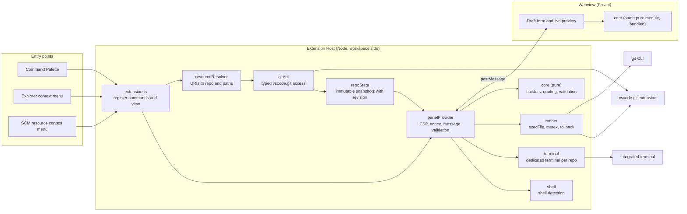
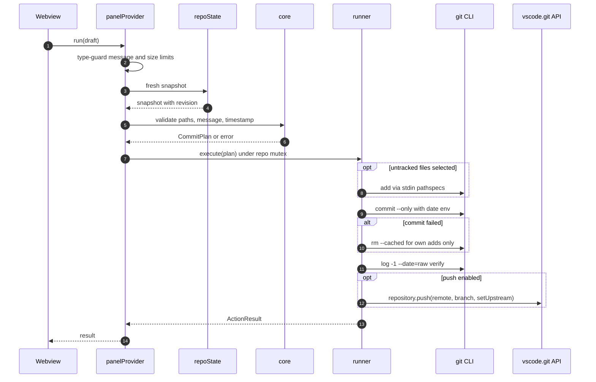
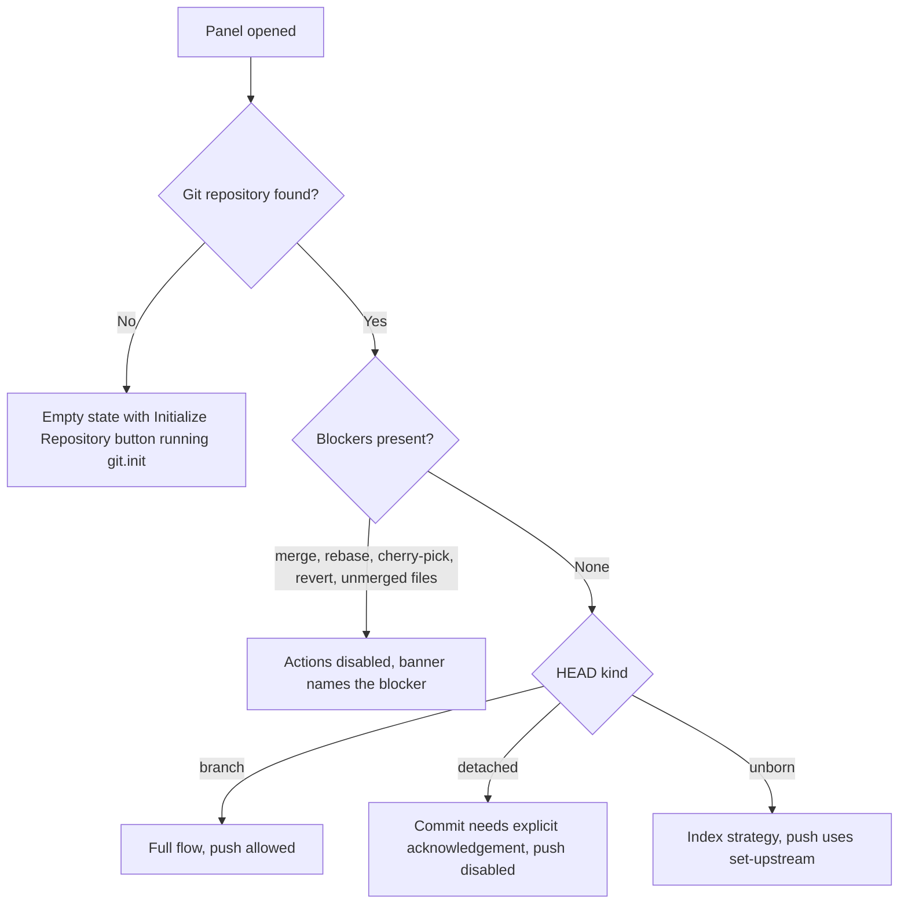

# Finalized System Architecture Blueprint: VS Code "Commit With Custom Date" Extension

**Status:** Final, executable from Phase 0. **Supersedes:** `vscode-git-backdate-blueprint.md`.

## 0. Ground Rules for the Implementing Agent

1. **Build only what this document specifies.** No extra features, abstractions, settings or defensive code for impossible states (YAGNI). Items in §14 are explicitly deferred.
2. **Placeholders (never replace with a brand name):**

| Token | Meaning | Used in |
|---|---|---|
| `<project-slug>` | npm/package `name` | `package.json#name`, repo folder |
| `<publisher-id>` | Marketplace publisher | `package.json#publisher` |
| `<extension-id>` | Namespace prefix for command, view and config IDs (set equal to `<project-slug>`) | `contributes.*` |
| `<display-name>` | Human title chosen by the owner later | `package.json#displayName` |

3. **Strictness:** TypeScript `strict`, `noUncheckedIndexedAccess`, `exactOptionalPropertyTypes`, `noImplicitOverride`; ESLint with the fitness rules in §5.2.
4. **Surgical edits:** when changing existing files in later phases, touch only the lines required and match the existing style.
5. **Every phase ends with its verification gate (§12).** Do not start the next phase until the gate passes.

---

## 1. Critical Audit of the Original Blueprint

| ID | Finding in original | Severity | Resolution in this blueprint |
|---|---|---|---|
| A1 | **VS Code Webview UI Toolkit is deprecated** (archived by Microsoft, FAST-based, no further fixes). | High | Dropped. Plain Preact + CSS using `--vscode-*` variables + `@vscode/codicons`. |
| A2 | "Run Now executes atomically." It cannot: `add` can succeed and `commit` can fail (hooks, signing, identity). | High | Explicit ordered steps with **rollback of only the extension's own `git add`** (§9.3). No atomicity claim. |
| A3 | "Send to Terminal without auto-running" is **false for multi-line text**: a newline in `sendText` is Enter and executes the earlier lines. | High | Terminal output is always **one line**; control characters are rejected (§8). |
| A4 | Command injection surface: commit messages, file names, **branch and remote names**, repo path all flow into shell strings. Escaping is described only for env vars. | Critical | Run Now never uses a shell (`execFile`, argv array). Terminal mode uses per-shell quoting plus **reject-don't-escape** for unsafe characters (§8). |
| A5 | Fish is detected but has **no adapter**; its quoting and env-prefix rules differ from POSIX. | Medium | Dedicated fish adapter (§8.2). |
| A6 | `vscode.env.shell` is the *default profile* shell, not necessarily the active terminal's shell. `activeTerminal` is unreliable for cwd. | Medium | Extension owns a **dedicated terminal** created with `cwd = repoRoot`; Copy mode embeds `git -C <root>`; shell override dropdown. |
| A7 | Pasting into the user's active terminal in a multi-root workspace can commit **the wrong repository** (cwd mismatch). | High | Same as A6. |
| A8 | `git add .` toggle sweeps in unrelated files and secrets. | High | Removed. Replaced by "Select all changed files" within the detected change list. |
| A9 | Staged files outside the selection would be swept into the commit by plain `git commit`. | High | Use `git commit --only -- <paths>`; other staged changes remain staged (§9.2). |
| A10 | Explicit `onView:` / `onCommand:` activation events are redundant (VS Code ≥ 1.74 derives them). | Low | `activationEvents: []`. |
| A11 | No Workspace Trust declaration. Git executes hooks, `core.sshCommand`, `core.fsmonitor` from repo config. | High | `untrustedWorkspaces.supported: false`, `virtualWorkspaces: false` (§6). |
| A12 | Remote scenarios (SSH, WSL, Codespaces): "local timezone" is ambiguous between UI client and extension host. | Medium | Offset is resolved **in the webview (user's clock)** and sent as a fixed `offsetMinutes`; host never uses JS local time (§7.1). |
| A13 | Credentials: silent `git push` via `child_process` hangs or fails without a TTY. | High | Push goes through `vscode.git`'s `Repository.push` (inherits askpass). Commit uses `execFile`. |
| A14 | Heatmap via `git log --format=%ad` over full history is O(commits), blocks on large repos, and is decorative. | Medium | **Cut** (§14). |
| A15 | Date amender via "automated non-interactive rebase" is high-risk history rewriting. | High | Cut from v1; optional Phase 5 is **HEAD-only and unpublished-only** (§14). |
| A16 | React + toolkit is heavy for a ~10-control form. | Low | Preact, one bundle < 60 KB gzip. |
| A17 | Extra Activity Bar container for one small form adds permanent UI. | Low | View contributed to the built-in **SCM** container, initially collapsed. `viewsContainers` intentionally omitted (fallback in §6.3). |
| A18 | Status bar item, syntax-highlighted preview: no functional value. | Low | **Cut.** Monospace preview only. |
| A19 | Webview not specified as untrusted: path/command strings from the webview would be trusted. | Critical | **Webview sends data, never commands.** Host re-validates everything against a fresh repo snapshot (§8.4). |

**Not a goal:** rewriting pushed history, force pushes, bypassing hooks (`--no-verify`), or touching commits older than `HEAD`.

---

## 2. Assumptions and Phase-0 Spikes

Assumptions are stated, not silently picked. Each has a spike that proves it and a fallback if it fails. Record results in `docs/spikes.md`.

| ID | Assumption | Spike | Fallback if false |
|---|---|---|---|
| S1 | `git --literal-pathspecs commit --only --pathspec-from-file=- --pathspec-file-nul -m …` commits exactly the listed tracked paths (modified, deleted, renamed with both paths) and leaves other staged changes staged. Min Git **2.26**. | Script on Git 2.26 and latest in a fixture repo. | Use `index` strategy everywhere with a pre-flight that requires `staged ⊆ selected`. |
| S2 | On an **unborn** branch, `commit --only` may be rejected. | Script. | Already the design: `index` strategy for unborn HEAD (§9.2). |
| S3 | `vscode.git` `Repository.state.workingTreeChanges` / `indexChanges` expose untracked files under default `git.untrackedChanges`. | Extension-host spike printing `Change.status`. | Build `files` from `git status --porcelain=v2 -z --untracked-files=all` in `repoState.ts`. |
| S4 | A `type: "webview"` view can be contributed to `views.scm`, and `<view-id>.focus` works. | Minimal manifest. | Use the `viewsContainers` fallback in §6.3. |
| S5 | `Repository.push(remote, branch, setUpstream)` exists on `engines.vscode` minimum and throws errors carrying `gitErrorCode`. | Call against a local bare remote. | Raise `engines.vscode`; else fall back to Send to Terminal for push. |
| S6 | Windows PowerShell 5.1 strips embedded `"` in native args and chains correctly with `$LASTEXITCODE`. | Run on Windows runner. | Keep rejecting `"` in PowerShell terminal output (already the design). |

---

## 3. Scope (v1)

**In:**
1. Explorer context menu, SCM resource context menu and Command Palette entry points.
2. One SCM-container webview: file selection, date/time/offset, optional random time in working hours, message, optional push, live command preview.
3. Three actions: **Copy**, **Send to Terminal**, **Run Now** (commit, verify, optional push).
4. Multi-root and submodule-aware repo resolution.
5. Single-repo-at-a-time panel.

**Out (deferred, §14):** heatmap, status bar item, date amender (Phase 5 optional), syntax highlighting, localization (`package.nls.json`).

---

## 4. Architecture

### 4.1 Component Diagram



### 4.2 Run Now Data Flow



### 4.3 Pre-flight Gating



### 4.4 State Management

- **Host is the source of truth** for repository facts: `RepoSnapshot` (immutable, monotonically increasing `revision`). Pushed to the webview on `repository.state.onDidChange`, debounced 250 ms.
- **Webview owns only the draft** (`CommitDraft`). Reducer (`useReducer`) plus `vscode.setState({ draft })` so drafts survive hide/show. `retainContextWhenHidden` stays **off** (memory cost).
- **Staleness:** every action carries `draft.revision`. Host re-reads the snapshot at execution time and rejects with `STALE_SELECTION` if any selected path is no longer in the changed set.
- **Concurrency:** one promise-queue mutex per `repoId`. UI disables actions while a request is in flight.
- **Deferred delivery:** if a context-menu command fires before the view is resolved, the host stores `pendingPreselect`, runs `<extension-id>.panel.focus`, and delivers on the webview's `ready`.

---

## 5. Project Layout

### 5.1 Directory Structure

```text
<project-slug>/
├── package.json
├── tsconfig.json                 # strict flags from §0.3
├── esbuild.mjs                   # two builds: host (node, cjs, external: vscode) and webview (browser, iife)
├── .vscodeignore
├── .eslintrc.cjs                 # fitness rules from §5.2
├── docs/spikes.md
├── src/
│   ├── core/                     # PURE: no 'vscode', no 'node:*' imports
│   │   ├── types.ts              # §7.1
│   │   ├── path.ts               # validateGitPath, toPosixRoot
│   │   ├── message.ts            # normalizeMessage
│   │   ├── timestamp.ts          # resolveTimestamp, localOffsetMinutesAt
│   │   ├── jitter.ts             # pickTimeInWindow(window, rng)
│   │   ├── quote.ts              # QUOTE_RULES
│   │   ├── shellRender.ts        # renderShell
│   │   └── execPlan.ts           # buildExecPlan
│   ├── shared/
│   │   └── protocol.ts           # §7.2 (imports types from core only)
│   ├── host/
│   │   ├── extension.ts          # activate(): commands, view registration
│   │   ├── vendor/git.d.ts       # vendored from microsoft/vscode extensions/git/src/api/git.d.ts
│   │   ├── gitApi.ts             # getAPI(1), git.path, version gate, repo lookup
│   │   ├── repoState.ts          # snapshot builder, blocker detection
│   │   ├── resourceResolver.ts   # normalize command args, group by repo
│   │   ├── shell.ts              # detectShell(vscode.env.shell)
│   │   ├── runner.ts             # ONLY file allowed to import child_process
│   │   ├── terminal.ts           # ONLY file allowed to call sendText
│   │   ├── messages.ts           # isWebviewToHost type guard
│   │   └── panelProvider.ts      # WebviewViewProvider, CSP, dispatch
│   └── webview/
│       ├── main.tsx
│       ├── App.tsx
│       ├── draftReducer.ts
│       ├── vscodeApi.ts          # typed acquireVsCodeApi wrapper
│       ├── styles.css
│       └── components/
│           ├── RepoPicker.tsx
│           ├── FileList.tsx
│           ├── DateTimeFields.tsx
│           ├── MessageFields.tsx   # includes fixed prefix chips: feat fix docs chore refactor test
│           ├── PushFields.tsx
│           ├── CommandPreview.tsx
│           └── ActionBar.tsx
└── test/
    ├── unit/                     # Vitest, core only
    ├── shell-matrix/             # spawns real shells against fixture repos
    └── integration/              # @vscode/test-cli, real extension host
```

### 5.2 Architecture Fitness Rules (enforced by lint, fail CI)

1. `src/core/**` may import only from `src/core/**`. No `vscode`, no `node:*`, no DOM globals.
2. `src/webview/**` may import only from `src/core/**` and `src/shared/**`.
3. `child_process` is imported **only** in `src/host/runner.ts`.
4. `Terminal.sendText` is called **only** in `src/host/terminal.ts`.
5. `innerHTML`, `dangerouslySetInnerHTML`, `eval`, `new Function` are banned in `src/webview/**`.
6. The host never accepts a command string from the webview. `protocol.ts` has no field of that kind.

---

## 6. `package.json`

### 6.1 Manifest Skeleton

```jsonc
{
  "name": "<project-slug>",
  "displayName": "<display-name>",
  "description": "Stage selected files and commit them with a custom author and committer date.",
  "version": "0.1.0",
  "publisher": "<publisher-id>",
  "license": "<license>",
  "engines": { "vscode": "^1.90.0" },
  "categories": ["SCM Providers"],
  "extensionKind": ["workspace"],
  "extensionDependencies": ["vscode.git"],
  "main": "./dist/extension.js",
  "activationEvents": [],
  "capabilities": {
    "virtualWorkspaces": {
      "supported": false,
      "description": "Requires a real working tree on disk."
    },
    "untrustedWorkspaces": {
      "supported": false,
      "description": "Running git executes repository hooks and repository-defined configuration."
    }
  },
  "scripts": {
    "build": "node esbuild.mjs",
    "watch": "node esbuild.mjs --watch",
    "lint": "eslint src test --max-warnings 0",
    "typecheck": "tsc --noEmit",
    "test": "vitest run",
    "test:shell": "vitest run --dir test/shell-matrix",
    "test:integration": "vscode-test",
    "package": "vsce package"
  },
  "contributes": { /* §6.2 */ }
}
```

No `browser` entry: the extension needs `child_process` and is desktop/remote-workspace only.

### 6.2 `contributes`

```jsonc
"contributes": {
  "commands": [
    {
      "command": "<extension-id>.open",
      "title": "Commit With Custom Date…",
      "category": "Git"
    },
    {
      "command": "<extension-id>.openForSelection",
      "title": "Commit With Custom Date…",
      "category": "Git"
    }
  ],

  "views": {
    "scm": [
      {
        "type": "webview",
        "id": "<extension-id>.panel",
        "name": "Commit With Custom Date",
        "when": "workspaceFolderCount > 0",
        "visibility": "collapsed"
      }
    ]
  },

  "menus": {
    "commandPalette": [
      { "command": "<extension-id>.open", "when": "workspaceFolderCount > 0" },
      { "command": "<extension-id>.openForSelection", "when": "false" }
    ],
    "explorer/context": [
      {
        "command": "<extension-id>.openForSelection",
        "when": "workspaceFolderCount > 0 && !explorerResourceIsRoot",
        "group": "7_modification@100"
      }
    ],
    "scm/resourceState/context": [
      {
        "command": "<extension-id>.openForSelection",
        "when": "scmProvider == git",
        "group": "1_modification@99"
      }
    ],
    "scm/resourceFolder/context": [
      {
        "command": "<extension-id>.openForSelection",
        "when": "scmProvider == git",
        "group": "1_modification@99"
      }
    ]
  },

  "configuration": {
    "title": "Commit With Custom Date",
    "properties": {
      "<extension-id>.shell": {
        "type": "string",
        "enum": ["auto", "bash", "zsh", "sh", "fish", "pwsh", "powershell", "cmd"],
        "default": "auto",
        "markdownDescription": "Shell dialect used for the Copy and Send to Terminal commands. `auto` follows the default terminal profile."
      },
      "<extension-id>.workingHours.start": {
        "type": "string",
        "pattern": "^([01]\\d|2[0-3]):[0-5]\\d$",
        "default": "09:30",
        "markdownDescription": "Start of the window used by **Random time in working hours** (24-hour `HH:MM`)."
      },
      "<extension-id>.workingHours.end": {
        "type": "string",
        "pattern": "^([01]\\d|2[0-3]):[0-5]\\d$",
        "default": "18:30",
        "markdownDescription": "End of the window used by **Random time in working hours** (24-hour `HH:MM`)."
      },
      "<extension-id>.push.defaultEnabled": {
        "type": "boolean",
        "default": false,
        "markdownDescription": "Whether the **Push after commit** option starts checked."
      },
      "<extension-id>.terminal.autoRun": {
        "type": "boolean",
        "default": false,
        "scope": "application",
        "markdownDescription": "Press Enter automatically after **Send to Terminal**. Application-scoped so a repository's `.vscode/settings.json` cannot enable it."
      }
    }
  }
}
```

Notes:
- `activationEvents` stays empty; VS Code derives them from `commands` and `views`.
- The `openForSelection` handler signature is `(...args: unknown[])`. Accepted shapes: Explorer `(clicked: Uri, selected: Uri[])`; SCM `(...SourceControlResourceState[])`. `resourceResolver.ts` normalizes both, drops non-`file:` URIs, and falls back to `window.activeTextEditor` only for the Palette command.

### 6.3 Fallback (use only if spike S4 fails)

```jsonc
"viewsContainers": {
  "activitybar": [
    { "id": "<extension-id>", "title": "Commit With Custom Date", "icon": "resources/icon.svg" }
  ]
},
"views": {
  "<extension-id>": [
    { "type": "webview", "id": "<extension-id>.panel", "name": "Commit With Custom Date" }
  ]
}
```

---

## 7. Strict TypeScript Interfaces

### 7.1 `src/core/types.ts`

```ts
/** Success/failure without exceptions. */
export type Result<T, E> =
  | { readonly ok: true; readonly value: T }
  | { readonly ok: false; readonly error: E };

declare const brand: unique symbol;
type Brand<T, B extends string> = T & { readonly [brand]: B };

/** Repo-relative, POSIX separators. No NUL/CR/LF, not absolute, no ".." segment, non-empty, <= 4096 chars. */
export type GitPath = Brand<string, "GitPath">;
/** /^[A-Za-z0-9][A-Za-z0-9._\/-]*$/, <= 255 chars. Must also exist in the repo's remote list. */
export type RemoteName = Brand<string, "RemoteName">;
/** Short branch name reported by vscode.git. Valid ref names may contain shell metacharacters: always quoted. */
export type BranchName = Brand<string, "BranchName">;

export type ShellKind = "bash" | "zsh" | "sh" | "fish" | "pwsh" | "powershell" | "cmd";
export type ShellSetting = "auto" | ShellKind;
export type DetectedShell = ShellKind | "unsupported";

// ---- Time -----------------------------------------------------------------

/** Wall-clock components as the user typed them. No timezone semantics. */
export interface LocalDateTime {
  readonly year: number;   // 1970..2099
  readonly month: number;  // 1..12
  readonly day: number;    // 1..31, validated against month/leap year
  readonly hour: number;   // 0..23
  readonly minute: number; // 0..59
  readonly second: number; // 0..59
}

export interface GitTimestamp {
  /** "YYYY-MM-DDTHH:MM:SS±HHMM" — the only format ever written into env vars or commands. */
  readonly iso: string;
  readonly epochSeconds: number;
  /** Minutes east of UTC. Range -720..+840. */
  readonly offsetMinutes: number;
}

export type TimestampError = "INVALID_DATE" | "INVALID_TIME" | "INVALID_OFFSET" | "OUT_OF_RANGE";

/** Pure arithmetic: epoch = Date.UTC(components) - offsetMinutes * 60_000. Never reads the machine timezone. */
export declare function resolveTimestamp(
  local: LocalDateTime,
  offsetMinutes: number,
): Result<GitTimestamp, TimestampError>;

/**
 * Webview-only helper (uses the browser's local zone, DST-aware).
 * Returns DST_GAP when the wall-clock time does not exist locally (spring-forward).
 * Ambiguous times (fall-back) resolve to the earlier occurrence.
 */
export declare function localOffsetMinutesAt(
  local: LocalDateTime,
): Result<number, "DST_GAP">;

export interface TimeWindow {
  readonly startMinutes: number; // minutes since 00:00
  readonly endMinutes: number;   // > startMinutes
}
/** rng returns [0,1). Injected for deterministic tests. */
export declare function pickTimeInWindow(
  window: TimeWindow,
  rng: () => number,
): Pick<LocalDateTime, "hour" | "minute" | "second">;

// ---- Message --------------------------------------------------------------

/**
 * Every paragraph is single-line, non-empty, trimmed, and free of NUL.
 * paragraphs[0] is the subject. Each paragraph becomes one `-m`.
 * Soft wraps inside a body paragraph are collapsed to one space (same rule in every mode).
 */
export interface NormalizedMessage {
  readonly paragraphs: readonly [string, ...string[]];
}
export type MessageError = "EMPTY_SUBJECT" | "SUBJECT_MULTILINE" | "TOO_LONG" | "NUL_CHARACTER";
// Limits: subject <= 500 chars, whole message <= 8192 chars. Soft warning (UI only) when subject > 72.
export declare function normalizeMessage(
  subject: string,
  body: string,
): Result<NormalizedMessage, MessageError>;

// ---- Plan -----------------------------------------------------------------

export interface PushSpec {
  readonly remote: RemoteName;
  readonly branch: BranchName;
  readonly setUpstream: boolean;
}

/**
 * "only":  git commit --only -- <paths>   (tracked HEAD present; other staged changes untouched)
 * "index": git add -- <paths> then git commit   (unborn HEAD; requires staged ⊆ selected)
 */
export type CommitStrategy = "only" | "index";

export interface CommitPlan {
  /** Absolute path. Used for `git -C` (Copy mode) and `cwd` (exec mode). */
  readonly repoRoot: string;
  /** Everything in the commit. Renames contribute both old and new path. */
  readonly paths: readonly GitPath[];
  /** Subset of `paths` unknown to git (needs `git add` first under strategy "only"). */
  readonly untrackedPaths: readonly GitPath[];
  readonly strategy: CommitStrategy;
  readonly message: NormalizedMessage;
  readonly timestamp: GitTimestamp;
  readonly push?: PushSpec;
}

// ---- Exec plan (Run Now: no shell involved) ---------------------------------

export type ExecStepId = "add" | "commit" | "verify" | "rollback";

export interface ExecStep {
  readonly id: ExecStepId;
  /** Arguments after the executable; passed as an argv array, never joined into a string. */
  readonly argv: readonly string[];
  /** NUL-separated pathspec list for --pathspec-from-file=- (UTF-8). */
  readonly stdin?: string;
  /** Merged over the sanitized base env. */
  readonly env?: Readonly<Record<string, string>>;
}

export interface ExecPlan {
  readonly steps: readonly ExecStep[]; // add?, commit, verify
  readonly rollback?: ExecStep;        // present iff plan added files itself
  readonly expected: { readonly epochSeconds: number; readonly offsetMinutes: number };
}
export declare function buildExecPlan(plan: CommitPlan): ExecPlan;

// ---- Shell render (Copy / Send to Terminal) ---------------------------------

export type RenderField = "message" | "path" | "repoRoot" | "branch" | "remote";

export type RenderError =
  | {
      readonly code: "UNSAFE_CHARACTER";
      readonly shell: ShellKind;
      readonly field: RenderField;
      /** Printable form, e.g. "U+0025 '%'" or "U+001B (control)". */
      readonly character: string;
    }
  | { readonly code: "COMMAND_TOO_LONG"; readonly length: number; readonly limit: number };

export interface RenderOptions {
  /** true for Copy (embed `git -C <root>`); false for Send (terminal cwd is the repo root). */
  readonly includeRepoDir: boolean;
}

export interface ShellRender {
  readonly shell: ShellKind;
  /** Exactly what is copied or sent. One line. Contains no control characters. */
  readonly singleLine: string;
}

export declare function renderShell(
  plan: CommitPlan,
  shell: ShellKind,
  options: RenderOptions,
): Result<ShellRender, RenderError>;

// ---- Quoting ----------------------------------------------------------------

export interface QuoteRule {
  /** Characters rejected outright for this shell (checked on every user-derived value). */
  readonly forbidden: RegExp;
  readonly quote: (value: string) => string;
}
export declare const QUOTE_RULES: Readonly<Record<ShellKind, QuoteRule>>;

export declare function validateGitPath(raw: string): Result<GitPath, "EMPTY" | "ABSOLUTE" | "TRAVERSAL" | "ILLEGAL_CHARACTER" | "TOO_LONG">;
export declare function toPosixRoot(absolutePath: string): string; // backslash to slash; strip trailing slash except drive/root
```

### 7.2 `src/shared/protocol.ts`

```ts
import type { DetectedShell, LocalDateTime, ShellSetting } from "../core/types";

export const PROTOCOL_VERSION = 1 as const;

/** Opaque to the webview. Host maps it to a repository root. */
export type RepoId = string;

// ---- Snapshot (host to webview) --------------------------------------------

export type FileChangeKind =
  | "modified" | "added" | "deleted" | "renamed" | "untracked" | "typechange" | "submodule";

export interface ChangedFile {
  /** POSIX, repo-relative. */
  readonly path: string;
  /** Present for renames. Host adds it to the pathspec automatically. */
  readonly oldPath?: string;
  readonly kind: FileChangeKind;
  readonly staged: boolean;
  readonly unstaged: boolean;
}

export type HeadState =
  | { readonly kind: "branch"; readonly name: string; readonly upstream?: string; readonly ahead: number; readonly behind: number }
  | { readonly kind: "detached"; readonly shortSha: string }
  | { readonly kind: "unborn"; readonly branch: string };

export type Blocker = "MERGE" | "REBASE" | "CHERRY_PICK" | "REVERT" | "UNMERGED_FILES";

export interface RepoSummary {
  readonly repoId: RepoId;
  readonly name: string;
}

export interface RepoSnapshot {
  readonly repoId: RepoId;
  readonly name: string;
  /** Monotonic per repo. Echoed back in CommitDraft.revision. */
  readonly revision: number;
  readonly head: HeadState;
  readonly remotes: readonly string[];
  /** Committer date of HEAD, for the "earlier than parent" warning. Absent when unborn. */
  readonly headCommitEpochSeconds?: number;
  readonly blockers: readonly Blocker[];
  /** Conflicted files are excluded (they raise UNMERGED_FILES). */
  readonly files: readonly ChangedFile[];
}

export interface HostEnv {
  readonly platform: "win32" | "darwin" | "linux";
  readonly detectedShell: DetectedShell;
  readonly shellSetting: ShellSetting;
  readonly workingHours: { readonly start: string; readonly end: string }; // "HH:MM"
  readonly pushDefaultEnabled: boolean;
  readonly autoRun: boolean;
  readonly gitVersionOk: boolean;
}

// ---- Draft (webview to host; DATA ONLY) --------------------------------------

export interface CommitDraft {
  readonly repoId: RepoId;
  readonly revision: number;
  /** Repo-relative POSIX paths chosen from the latest snapshot. Re-validated by the host. */
  readonly paths: readonly string[];
  readonly message: { readonly subject: string; readonly body: string };
  /** Offset already resolved in the webview (user's clock). Host never reads local timezone. */
  readonly when: { readonly local: LocalDateTime; readonly offsetMinutes: number };
  readonly push: { readonly enabled: boolean; readonly remote: string };
  readonly shell: ShellSetting;
}

// ---- Results ------------------------------------------------------------------

export type RunStepId = "preflight" | "add" | "commit" | "verify" | "push";

export type ErrorCode =
  | "MALFORMED_REQUEST" | "STALE_SELECTION" | "BLOCKED" | "GIT_TOO_OLD"
  | "PATH_REJECTED" | "MESSAGE_REJECTED" | "DATE_REJECTED"
  | "UNSAFE_CHARACTER" | "COMMAND_TOO_LONG" | "UNSUPPORTED_SHELL"
  | "NOTHING_TO_COMMIT" | "IDENTITY_MISSING" | "INDEX_LOCKED"
  | "HOOK_REJECTED" | "SIGNING_FAILED" | "GIT_FAILED"
  | "PUSH_REJECTED" | "AUTH_FAILED" | "NETWORK" | "CANCELLED" | "TIMEOUT" | "INTERNAL";

export type ActionResult =
  | { readonly ok: true; readonly action: "copy" | "sendToTerminal" }
  | {
      readonly ok: true;
      readonly action: "run";
      readonly commitSha: string;
      /** false if post-commit date verification disagreed (commit exists; user is told). */
      readonly verified: boolean;
      readonly pushed: boolean;
    }
  | {
      readonly ok: false;
      readonly code: ErrorCode;
      readonly step?: RunStepId;
      /** ANSI-stripped, truncated to 4 KB. Rendered as text only. */
      readonly message: string;
      readonly rolledBack: boolean;
      /** Offered when Run Now cannot work but the terminal might (signing prompt, credentials). */
      readonly fallback?: "sendToTerminal";
    };

// ---- Messages -------------------------------------------------------------------

export type WebviewToHost =
  | { readonly type: "ready"; readonly protocolVersion: number }
  | { readonly type: "selectRepo"; readonly repoId: RepoId }
  | { readonly type: "initRepository" }
  | { readonly type: "copy"; readonly requestId: string; readonly draft: CommitDraft }
  | { readonly type: "sendToTerminal"; readonly requestId: string; readonly draft: CommitDraft }
  | { readonly type: "run"; readonly requestId: string; readonly draft: CommitDraft }
  | { readonly type: "cancel"; readonly requestId: string };

export type HostToWebview =
  | {
      readonly type: "init";
      readonly protocolVersion: typeof PROTOCOL_VERSION;
      readonly env: HostEnv;
      readonly repos: readonly RepoSummary[];
      readonly activeRepoId?: RepoId;
      readonly snapshot?: RepoSnapshot;
    }
  | { readonly type: "snapshot"; readonly snapshot: RepoSnapshot }
  | {
      readonly type: "preselect";
      readonly repoId: RepoId;
      readonly paths: readonly string[];
      /** Selected resources that belonged to other repos or had no changes. */
      readonly droppedCount: number;
    }
  | {
      readonly type: "progress";
      readonly requestId: string;
      readonly step: RunStepId;
      readonly status: "start" | "ok" | "fail";
    }
  | { readonly type: "result"; readonly requestId: string; readonly result: ActionResult };

export function assertNever(x: never): never {
  throw new Error(`Unhandled variant: ${JSON.stringify(x)}`);
}
```

**`isWebviewToHost(raw: unknown)` (in `host/messages.ts`) must enforce:** known `type`; `requestId` is a string ≤ 64 chars; `paths.length ≤ 20 000`, each path string ≤ 4096; `subject ≤ 500`, `body ≤ 8192`; all numbers finite integers; `shell` in the allowed enum; unknown extra keys ignored; failure returns `MALFORMED_REQUEST` and logs once to the extension's output channel.

---

## 8. Security and Shell Escaping

### 8.1 Principles

1. **Webview sends data, never commands.** The host rebuilds `CommitPlan` from `CommitDraft` and the fresh snapshot; any command text shown in the webview is advisory (computed by the same pure `core`).
2. **Run Now never touches a shell.** `execFile(gitPath, argv, { shell: false, cwd: repoRoot, windowsHide: true })`. If `git.path` ends in `.cmd` or `.bat`, refuse (`GIT_FAILED`, "use git.exe").
3. **Reject, don't escape, where escaping is unreliable** (cmd, PowerShell double quotes, all control characters).
4. **All user-, repo- and filesystem-derived values are untrusted:** commit message, file paths, repo root, branch names, remote names. Branch names such as `a;touch x` are valid refs.
5. **Always** pass `--literal-pathspecs` so `:(glob)`, `*`, `:!` magic in file names is inert; **always** terminate path lists with `--` (terminal) or use `--pathspec-from-file=- --pathspec-file-nul` (exec).
6. Never emit `--no-verify`, `--force`, `--force-with-lease`, `git add .`, `git add -A`.
7. Terminal commands are **one line**, contain **no C0/C1 control characters**, and are not auto-executed unless `terminal.autoRun` (application scope) is true.

### 8.2 Escaping Matrix

Common rejection set `R0` (every shell, every user-derived value in terminal mode):
`U+0000–U+001F` (includes TAB, CR, LF, ESC), `U+007F–U+009F`, `U+2028`, `U+2029`, bidi controls `U+202A–U+202E`, `U+2066–U+2069`.
(Run Now only rejects NUL; tabs and other characters are passed verbatim as argv.)

| Shell | String literal | Escape rule | Extra rejected chars | Env scoping for dates | Chaining | Pitfalls neutralized |
|---|---|---|---|---|---|---|
| **bash** | `'…'` | `'` becomes `'\''` | `R0` | Inline prefix `GIT_AUTHOR_DATE='…' GIT_COMMITTER_DATE='…' git …` | `&&` | `$()`, backticks, `!` history expansion, `;`, `&`, `\|` all inert inside single quotes. Tested on macOS bash 3.2. |
| **zsh** | `'…'` | same as bash | `R0` | same as bash | `&&` | `RC_QUOTES` is off by default; single quotes still literal. |
| **sh** (dash/ash) | `'…'` | same as bash | `R0` | same as bash | `&&` | POSIX only constructs. |
| **fish** | `'…'` | `\` becomes `\\`, then `'` becomes `\'` (fish single quotes honour only these two escapes) | `R0` | `env GIT_AUTHOR_DATE='…' GIT_COMMITTER_DATE='…' git …` (prefix form works on every fish version via `env`) | `&&` (fish ≥ 3.0) | `$var`, `~`, `*` inert in single quotes. |
| **pwsh** (7+) | `'…'` | double every `'` **and** the typographic quotes `‘ ’ ‚ ‛` (PowerShell treats all four as single quotes) | `R0` + `"` | `try { $env:GIT_AUTHOR_DATE='…'; $env:GIT_COMMITTER_DATE='…'; git … } finally { Remove-Item Env:GIT_AUTHOR_DATE,Env:GIT_COMMITTER_DATE -ErrorAction SilentlyContinue }` | Nested `; if ($LASTEXITCODE -eq 0) { … }` | Native-arg quote mangling differs by version (`$PSNativeCommandArgumentPassing`); rejecting `"` removes the ambiguity. `$`, backtick, `@`, `{}` inert in single quotes. |
| **powershell** (5.1) | same as pwsh | same as pwsh | same as pwsh | same as pwsh | same as pwsh (`&&` is unavailable in 5.1) | Same; 5.1 is the version where `"` is stripped. |
| **cmd** | `"…"` | none (no escaping is attempted) | `R0` + `"` `%` `^` `!` | `(set "GIT_AUTHOR_DATE=…" && set "GIT_COMMITTER_DATE=…" && git … ) & set "GIT_AUTHOR_DATE=" & set "GIT_COMMITTER_DATE="` (cleanup runs regardless of success) | `&&` inside `( … )` | Inside double quotes `& \| < > ( )` are literal; `%VAR%`, `^` and delayed-expansion `!` are not, so they are rejected. |

**Windows path rule:** repo root in `-C` is converted to forward slashes with the trailing slash stripped (except `C:/` and `/`), avoiding the trailing-backslash-before-quote argv bug in both cmd and legacy PowerShell. Repo-relative paths are already POSIX.

**Length limits:** `cmd` 8000 characters, all others 32 000. Over the limit returns `COMMAND_TOO_LONG` ("Use Run Now or select fewer files").

### 8.3 Command Templates

`P…` is the quoted path list; `M…` is `-m <q(p1)> -m <q(p2)> …`; `D` is `timestamp.iso`; `R` is the quoted root (present only when `includeRepoDir`; the `-C R` pair is omitted otherwise). `G` means `git [-C R] --literal-pathspecs`.

**Strategy `only`** (units in order; the `add` unit exists only if `untrackedPaths` is non-empty; the `push` unit only if `plan.push`):

1. `G add -- <untracked quoted paths>`
2. `G commit --only --cleanup=whitespace M… -- P…` (with the shell's env-scoping from §8.2)
3. `git [-C R] push [-u] <q(remote)> <q(branch)>`

**Strategy `index`:** unit 1 becomes `G add -- P…` (all paths); unit 2 drops `--only` and the `-- P…`.

Chaining by shell: bash/zsh/sh/fish/cmd join units with ` && `; PowerShell nests `unit1; if ($LASTEXITCODE -eq 0) { unit2; if ($LASTEXITCODE -eq 0) { unit3 } }`; cmd wraps the whole chain as in the matrix.

Example (bash, strategy `only`, no push):

```bash
git -C '/home/me/repo' --literal-pathspecs add -- 'new file.ts' && GIT_AUTHOR_DATE='2026-03-02T10:41:07+0530' GIT_COMMITTER_DATE='2026-03-02T10:41:07+0530' git -C '/home/me/repo' --literal-pathspecs commit --only --cleanup=whitespace -m 'fix: handle empty input' -m 'Covers the null case.' -- 'src/a.ts' 'new file.ts'
```

### 8.4 Threat to Mitigation Map

| Threat | Mitigation |
|---|---|
| Shell metacharacters in commit message | Run Now: argv array, no shell. Terminal: per-shell quoting, `R0`/cmd/PowerShell rejection sets (§8.2). |
| Option injection (`-m` value or path starting with `-`) | `-m` consumes the next argv as its value; paths use `--` or `--pathspec-from-file`. |
| Pathspec magic (`:(top)`, `*`, `:!x`) | `--literal-pathspecs` globally. |
| Path traversal / absolute path from a forged webview message | Each path must be (a) `validateGitPath`-valid and (b) a member of the host's fresh snapshot file set. |
| Malicious branch/remote names (`a;rm -rf ~`) | `RemoteName` regex + membership in `repository.state.remotes` + not starting with `-`; branch always quoted; cmd rejects unsafe chars. |
| Terminal escape sequences, tab-completion or Enter via message text | `R0` rejection in every terminal render; single line only. |
| Bidirectional-text spoofing in the preview | Bidi controls in `R0`. |
| Environment confusion | Base env sanitized: delete `GIT_DIR`, `GIT_WORK_TREE`, `GIT_INDEX_FILE`, `GIT_AUTHOR_*`, `GIT_COMMITTER_*`; set `GIT_TERMINAL_PROMPT=0`, `LC_MESSAGES=C` (stable stderr for classification). |
| Malicious repo config/hooks | Workspace Trust required; hooks are **not** skipped. |
| Webview XSS / CSP bypass | Nonce-only `script-src`, no inline styles/handlers, `localResourceRoots` limited to `dist/webview`, `enableCommandUris: false`, no remote content, `innerHTML` lint-banned. |
| Forged or malformed IPC | Type guard + size limits + request mutex; unknown messages dropped. |
| stderr containing control or ANSI sequences | Strip ANSI, truncate to 4 KB, render via text nodes. |
| Workspace settings enabling auto-run | `terminal.autoRun` has `scope: "application"`. |
| Supply chain | Host has zero runtime dependencies; webview bundles only `preact` and `@vscode/codicons`; lockfile committed; `npm audit` in CI. |

### 8.5 Webview CSP

```text
default-src 'none';
img-src ${webview.cspSource} data:;
style-src ${webview.cspSource};
font-src ${webview.cspSource};
script-src 'nonce-${nonce}';
```

- `nonce = crypto.randomBytes(16).toString('base64')` per `resolveWebviewView`.
- CSS is loaded from `<link>`; **no `style="…"` attributes in markup** (blocked by this CSP). Preact style objects (CSSOM) are allowed but should be avoided in favour of classes.
- Honour themes via `body.vscode-light` / `body.vscode-dark` / `body.vscode-high-contrast` classes; set `color-scheme` per class so native date/time inputs match.

---

## 9. Execution Semantics

### 9.1 Git Environment and Process Settings

- Executable: `api.git.path` from the `vscode.git` API (respects the `git.path` setting). Version checked once with `git --version`; **minimum 2.26** (`--pathspec-from-file` support in `add`, `commit`, `rm`). Below that: `gitVersionOk=false`, Run Now disabled, Copy/Send still work with a banner.
- `timeout`: 120 s for add/commit/verify; `maxBuffer`: 10 MB; stdout/stderr decoded as UTF-8.
- `INDEX_LOCKED`: if stderr contains `index.lock`, retry once after 300 ms, then surface the error.

### 9.2 Strategy Selection

| HEAD | Strategy | Reason |
|---|---|---|
| `branch` or `detached` | `only` | Leaves other staged changes untouched. |
| `unborn` | `index` (subject to S2) | `--only` may not apply without HEAD. Pre-flight requires `staged ⊆ selected`, otherwise `BLOCKED` with the list of extra staged paths. |

### 9.3 Step Specification (Run Now)

| # | Step | argv (after `git`) | stdin | Env additions |
|---|---|---|---|---|
| 1 | `add` (only if `untrackedPaths` non-empty; strategy `index` adds all `paths`) | `--literal-pathspecs add --pathspec-from-file=- --pathspec-file-nul` | paths joined by `\0`, trailing `\0` | none |
| 2 | `commit` (`only`) | `--literal-pathspecs commit --only --cleanup=whitespace -m <p1> [-m <pN>…] --pathspec-from-file=- --pathspec-file-nul` | all `paths`, NUL-joined | `GIT_AUTHOR_DATE`, `GIT_COMMITTER_DATE` = `timestamp.iso` |
| 2 | `commit` (`index`) | `commit --cleanup=whitespace -m <p1> [-m <pN>…]` | none | same dates |
| 3 | `verify` | `log -1 --format=%H%x00%ad%x00%cd --date=raw` | none | none |
| R | `rollback` (only when step 1 ran and step 2 failed) | `--literal-pathspecs rm --cached -q --ignore-unmatch --pathspec-from-file=- --pathspec-file-nul` | only the paths this run added | none |

- `--cleanup=whitespace` is explicit so the user's `commit.cleanup` config cannot change the stored message.
- **Verify** parses `<epoch> <±HHMM>` for author and committer and compares to `expected`. Mismatch sets `verified:false` (the commit exists; never auto-undone) and the UI says so.
- **Rollback scope is exactly the files this run staged.** Anything staged before the run is never touched.
- **Hooks** (`pre-commit`, `commit-msg`) run normally. Failure maps to `HOOK_REJECTED` with stderr tail.

### 9.4 Push

- Executed through `repository.push(remote, branch, setUpstream)` from `vscode.git`, which provides credential prompts and progress. `setUpstream` is true iff the branch has no upstream.
- Preconditions: `head.kind === 'branch'`; `remote` ∈ `snapshot.remotes`; not behind its upstream (if `behind > 0` show a warning, still attempt; git rejects non-fast-forward).
- Error mapping (via `gitErrorCode`, verified in S5): `PushRejected` → `PUSH_REJECTED`; `AuthenticationFailed` → `AUTH_FAILED` (offer fallback `sendToTerminal`); `RemoteConnectionError` → `NETWORK`; cancellation → `CANCELLED`.
- If commit succeeded but push failed, the result is `ok:false, step:'push'`, and the message states **"Commit created locally; push failed."**
- After any run: `await repository.status()` to refresh SCM immediately.

### 9.5 Stderr Classification (with `LC_MESSAGES=C`)

| Pattern | Code |
|---|---|
| `nothing (added )?to commit` or `no changes added to commit` | `NOTHING_TO_COMMIT` |
| `Please tell me who you are` or `unable to auto-detect email address` | `IDENTITY_MISSING` |
| `index\.lock` | `INDEX_LOCKED` |
| `gpg failed to sign` | `SIGNING_FAILED` (fallback: `sendToTerminal`, since a TTY pinentry may be needed) |
| `(pre-commit\|commit-msg\|prepare-commit-msg) hook` | `HOOK_REJECTED` |
| otherwise non-zero exit | `GIT_FAILED` |

---

## 10. Edge-Case Handling Strategy

| Scenario | Detection | v1 behaviour |
|---|---|---|
| **No git repository / uninitialized folder** | `api.repositories.length === 0` | Empty state with **Initialize Repository** (runs built-in `git.init`). Actions hidden. |
| **`vscode.git` disabled** (`git.enabled=false`) | Extension dependency fails or `getAPI(1)` state is `uninitialized` | Single-line error with a link to the `git.enabled` setting. |
| **File outside any repo** | `api.getRepository(uri)` is null | Dropped; counted in `droppedCount`; notification "N paths are not in a Git repository." |
| **Multi-root workspace** | Multiple repositories | Panel is single-repo. Repo picker appears when > 1. Context-menu selection spanning repos opens the first repo, the rest counted as dropped. |
| **Submodule** | `vscode.git` lists it as its own repository (`git.detectSubmodules`) | File inside a submodule resolves to the submodule's repo (`getRepository` returns the closest root). In the parent repo, a changed submodule appears as `kind:"submodule"` (pointer update), labelled as such, selectable. |
| **Worktree / `.git` file** | n/a | Always use `repository.rootUri.fsPath` and `-C`/`cwd`; never assume a `.git` directory. Locate special files with `git rev-parse --git-path`. |
| **Detached HEAD** | `head.kind === 'detached'` | Inline warning "Commit won't belong to a branch"; Commit button requires ticking an acknowledgement checkbox; push option disabled. |
| **Unborn branch (no commits)** | `head.kind === 'unborn'` | `index` strategy; "earlier than parent" check skipped; push uses `-u`. |
| **Merge / rebase / cherry-pick / revert in progress** | `state.mergeChanges`, `state.rebaseCommit`, plus `git rev-parse --git-path MERGE_HEAD\|CHERRY_PICK_HEAD\|REVERT_HEAD\|rebase-merge\|rebase-apply` existence | `blockers` non-empty, all actions disabled, banner names the operation. (`--only` is also illegal during a merge.) |
| **Merge conflicts (unmerged files)** | Conflicted entries in `mergeChanges` | `UNMERGED_FILES` blocker; conflicted paths never shown as selectable. |
| **Rename** | `Change.originalUri` present | Both `oldPath` and `path` added to the pathspec automatically. |
| **Deleted file** | `kind:"deleted"` | Allowed; `commit --only` records the deletion. |
| **Partially staged file** | `staged && unstaged` | Allowed under `only` (the working-tree version is committed). UI shows a "partially staged" chip with tooltip. |
| **Date in the future** | `epoch > now + 300 s` | Inline warning, not blocking. |
| **Date earlier than HEAD committer date** | `epoch < headCommitEpochSeconds` | Inline warning "History will be non-chronological", not blocking. |
| **Date outside 1970-01-02 … 2099-12-31** | `resolveTimestamp` | `DATE_REJECTED`. |
| **DST gap local time** | `localOffsetMinutesAt` returns `DST_GAP` | Inline error in the webview; fixed-offset selection remains possible. |
| **Already-pushed commits (v1)** | Not applicable: v1 only creates **new** commits and never rewrites. | Push of the new commit is a normal fast-forward. If the upstream is ahead (`behind > 0`) warn "Pull first"; rejection surfaces as `PUSH_REJECTED`. **Never force.** |
| **Already-pushed commits (Phase 5 amend)** | `git merge-base --is-ancestor HEAD @{upstream}` succeeds, or `git branch -r --contains HEAD` is non-empty | Hard block: "Commit is already on a remote; changing its date would require a force push (unsupported)." No override. |
| **Hooks fail after our `git add`** | commit exit ≠ 0 | Rollback (§9.3). Result `rolledBack:true`. |
| **GPG signing needs a TTY** | `gpg failed to sign` | `SIGNING_FAILED` with **Send to Terminal** fallback. |
| **No `user.name` / `user.email`** | stderr match | `IDENTITY_MISSING` with the two `git config` commands as guidance text. |
| **Nothing to commit** (selected files no longer changed) | Snapshot membership check, or stderr | `STALE_SELECTION` or `NOTHING_TO_COMMIT`. |
| **`index.lock` contention with `vscode.git`** | stderr | One retry after 300 ms. |
| **Very large selection (> 5 000 files)** | `paths.length` | Run Now works (stdin pathspecs, no ARG_MAX). Terminal render may return `COMMAND_TOO_LONG`. File list renders up to 2 000 rows plus filter box. |
| **Unknown shell** (`nu`, `xonsh`, `elvish`, …) | `detectShell` returns `unsupported` | Copy/Send disabled until the user picks a dialect in the dropdown; Run Now unaffected. |
| **WSL launched from a Windows-local VS Code** | `vscode.env.shell` is `wsl.exe` | Treated as `bash`; `includeRepoDir` forced false (Windows paths are not valid in WSL); banner "Run from the repository root." |
| **macOS Unicode path normalization (NFC/NFD)** | n/a | Paths are taken from `vscode.git` as reported; covered by an integration test with an accented file name. |
| **Webview reload / panel hidden** | `ready` message | Host replays `init`; draft restored from `vscode.getState()`. |

---

## 11. UX Specification

**Layout (top to bottom):** repo picker (only if > 1 repo) → blockers/warnings banner → files (filter, "Select all changed", count) → date, time (seconds, 24 h), offset (`Local (+05:30)` default, or fixed list in 15-minute steps from −12:00 to +14:00) with **Random time in working hours** button → subject (live counter, soft warning > 72) and body, plus fixed prefix chips (`feat:` `fix:` `docs:` `chore:` `refactor:` `test:`) → **Push after commit** + remote select → shell dropdown and read-only wrapped preview → actions.

**Actions:** `Copy`, `Send to Terminal`, and primary `Commit N files` (Run Now). Disabled-reason tooltip on every disabled control. Progress shows the step names inline (`add → commit → verify → push`) in an `aria-live="polite"` region. Success: native information message `Committed <short-sha> at <iso>` with **Copy SHA**.

**Rules:**
- Preview always shows the exact `singleLine` that Copy/Send will use. A render error replaces the preview with the sentence "Not allowed in <shell> commands: <char>. Use Run Now or another shell."
- Keyboard-accessible, visible focus rings, no animations (honours `prefers-reduced-motion` trivially), colours only from `--vscode-*` variables (high-contrast safe).
- Changing repo clears the path selection; changing date/time while offset mode is `local` recomputes the offset.
- Context-menu pre-selection uses `preselect`; folders expand to all changed files under that prefix.
- Terminal: one terminal per repo named after the repo, created with `cwd = repoRoot`, reused while alive; `terminal.show(true)` preserves editor focus.

---

## 12. Step-by-Step Implementation and Verification Plan

Format: `N. [Action] → Verification: [Specific check]`. A phase gate must be green before the next phase starts.

### Phase 0 — Scaffold and Spikes
1. Scaffold `package.json`, `tsconfig.json` (strict flags), esbuild dual build, ESLint with §5.2 rules, Vitest, `.vscodeignore` → Verification: `npm run typecheck && npm run lint && npm test` pass on an empty `core` stub; deliberately adding `import "vscode"` to `src/core/x.ts` makes lint fail.
2. Run spikes S1, S2 in a script against fixture repos (modified, deleted, renamed, untracked-added, partially staged, unborn) on Git 2.26 and latest → Verification: `docs/spikes.md` records pass/fail with the exact commands; S1 asserts other staged files remain staged after the commit.
3. Run spikes S3, S4, S5 in a minimal extension host → Verification: screenshots/log lines in `docs/spikes.md`; fallbacks adopted where a spike failed.
4. Run spike S6 on a Windows runner → Verification: log shows `"` mangling in 5.1 and `$LASTEXITCODE` chaining behaviour.

**Gate 0:** all six spikes have a recorded outcome and, if negative, the fallback is written into §2 of the repo's copy of this document.

### Phase 1 — Pure Core and Tests
5. Implement `types.ts`, `path.ts`, `message.ts` → Verification: unit tests cover empty subject, multi-line subject, NUL, 500/8192 limits, soft-wrap collapse, paragraph split, `..`/absolute/NUL/over-length paths; coverage ≥ 95 % lines for these files.
6. Implement `timestamp.ts` and `jitter.ts` → Verification: tests for leap day, Feb 30 rejection, 1970-01-01 rejection, 2099-12-31 acceptance, offsets −12:00/+05:30/+05:45/+14:00, ISO output matches `/^\d{4}-\d\d-\d\dT\d\d:\d\d:\d\d[+-]\d{4}$/`, jitter stays inside the window for 10 000 seeded draws.
7. Implement `quote.ts` and `shellRender.ts` for all seven shells → Verification: snapshot tests of exact output for the §13.1 vectors per shell; property test (fast-check) asserts rendered output never contains a character in the shell's forbidden set outside of quote-wrapped values and never contains a newline.
8. Implement `execPlan.ts` → Verification: unit tests assert exact argv arrays and stdin for `only`/`index`, with/without untracked paths, 1 and 3 paragraphs; assert no argv element is a joined shell string.
9. Build the shell-matrix harness (`test/shell-matrix`) → Verification: on CI (ubuntu: bash, dash, zsh, fish, pwsh; macOS: zsh, bash 3.2; windows: cmd, powershell 5.1, pwsh, Git Bash) every §13.1 vector either (a) produces a commit whose `git log -1 --format=%B` equals the expected message, with correct author and committer dates, and **no canary file** exists, or (b) is rejected by `renderShell` exactly as the matrix predicts.

**Gate 1:** unit + shell-matrix suites green on all three OS runners.

### Phase 2 — Extension Host and Git Context
10. Implement `gitApi.ts`, `shell.ts`, `repoState.ts`, `resourceResolver.ts` → Verification: integration tests (real extension host, fixture workspaces) for single repo, two-root workspace, submodule, nested file in submodule, no repo; asserts snapshot file lists, `droppedCount`, blocker detection for merge, cherry-pick, rebase, unmerged files.
11. Implement `messages.ts` type guard → Verification: table-driven unit tests with malformed, oversized and extra-key payloads; all malformed inputs rejected, none throw.
12. Implement `runner.ts` (mutex, env sanitization, retry on `index.lock`, rollback, verify, error classification) → Verification: integration tests: success; hook failing after own add (index restored, pre-staged files untouched, `rolledBack:true`); identity missing; nothing to commit; concurrent double invocation serialized; inherited `GIT_DIR` ignored.
13. Implement push via `repository.push` → Verification: against a local bare remote: new branch pushes with `-u`; rejected non-fast-forward maps to `PUSH_REJECTED`; no force flag ever present (asserted by wrapping the API in a test double).

**Gate 2:** all integration tests green on ubuntu and windows; manual run in Extension Development Host commits one file with a past date and `git log -1 --format='%ad|%cd' --date=iso-strict` shows the chosen date for both.

### Phase 3 — Webview UI and IPC
14. Implement `panelProvider.ts` (CSP, nonce, `asWebviewUri`, `ready`/`init` handshake, `pendingPreselect`) → Verification: automated check that the rendered HTML contains the exact CSP in §8.5, a fresh nonce per resolve, and no inline `style=`/`on*=` attributes; DevTools console shows zero CSP violations.
15. Implement the Preact app, `draftReducer`, state persistence, live preview using bundled `core` → Verification: component tests for reducer transitions (repo switch clears paths; local offset recomputes on date change; DST-gap error); manual check in Dark+, Light+, High Contrast; bundle size < 60 KB gzip (CI asserts).
16. Wire `selectRepo`, `copy`, `run`, `cancel`, `progress`, `result`, `snapshot`, `preselect` → Verification: integration test drives the webview by posting messages, asserts host replies and that a forged `paths` entry not in the snapshot yields `STALE_SELECTION` and runs no git command.

**Gate 3:** Explorer right-click, SCM right-click and Palette each open the panel with correct pre-selection; the preview text equals what Copy places on the clipboard (byte-compare in test).

### Phase 4 — Terminal and Hardening
17. Implement `terminal.ts` (dedicated terminal per repo, `cwd`, `sendText(text, autoRun)`) → Verification: integration test confirms the terminal's `creationOptions.cwd` equals the repo root and that, with `autoRun=false`, the command is not executed (canary not created until Enter is simulated).
18. Enforce `terminal.autoRun` application scope → Verification: a workspace `.vscode/settings.json` setting `autoRun:true` has no effect (test reads effective value).
19. Complete unsupported-shell, `COMMAND_TOO_LONG`, detached-HEAD acknowledgement and unborn-branch flows → Verification: one integration test per row of §10 marked "v1 behaviour" that names a UI state, asserting the snapshot/flags and the result code.
20. Package with `vsce package` and install the VSIX in a clean profile → Verification: activation time < 50 ms (measured via `Developer: Show Running Extensions`), no unhandled rejections in the Extension Host log, `vsce ls` contains only `dist/`, `package.json`, README, LICENSE.

**Gate 4 (v1 release):** §15 Definition of Done is satisfied.

### Phase 5 — Optional HEAD Date Amender (only after Gate 4)
21. Implement `isPublished(sha)` and the amend command (§14.2) → Verification: tests: unpublished HEAD amends and keeps staged changes untouched; published HEAD is hard-blocked with the message in §10; the working tree and index are byte-identical before and after.

---

## 13. Test Assets

### 13.1 Hostile Vectors (messages; also used as file names where the OS allows)

| # | Value | Expected in terminal mode |
|---|---|---|
| 1 | `it's` | quoted per shell, round-trips |
| 2 | `say "hi"` | round-trips on POSIX/fish; rejected on pwsh, powershell, cmd |
| 3 | `$(touch canary)` | round-trips literally on POSIX/fish/PowerShell; cmd round-trips literally |
| 4 | `` `touch canary` `` | round-trips literally (PowerShell backtick is inert in single quotes) |
| 5 | `a; touch canary` | round-trips literally |
| 6 | `a && touch canary` | round-trips literally |
| 7 | `a \| cat` and `a > canary` | round-trips literally (cmd: literal inside quotes) |
| 8 | `-n` and `--amend` | round-trips as message text |
| 9 | `100%` and `%PATH%` | cmd rejected; others round-trip |
| 10 | `wow!!` | cmd rejected; others round-trip (no history expansion in single quotes) |
| 11 | `^&` | cmd rejected; others round-trip |
| 12 | `‘smart’ ’quotes’` | PowerShell doubled-quote rule round-trips |
| 13 | `日本語 🙂` | round-trips (UTF-8) |
| 14 | `back\slash` and trailing `\` | POSIX round-trips; fish `\\` rule round-trips |
| 15 | `# not a comment` | round-trips |
| 16 | `a<ESC>b`, `a<TAB>b`, `a<CR>b` | rejected in every terminal render; Run Now passes tab, rejects NUL only |
| 17 | `a<U+202E>b` | rejected |
| 18 | 8 192-character message | accepted; 8 193 rejected (`TOO_LONG`) |
| 19 | Branch `x;touch canary`, remote `-oProxyCommand=x` | branch quoted/ rejected on cmd; remote rejected by `RemoteName` |
| 20 | Path `:(glob)*.ts`, `*.ts`, `-weird`, `sp ace`, `quote'd` | literal pathspec behaviour, no glob expansion, no option injection |

### 13.2 CI Matrix

| Runner | Shells exercised |
|---|---|
| `ubuntu-latest` | bash, dash (`sh`), zsh, fish, pwsh |
| `macos-latest` | zsh, bash 3.2 (`/bin/bash`), pwsh |
| `windows-latest` | cmd, powershell 5.1, pwsh, Git Bash |

Jobs: `typecheck`, `lint`, `unit`, `shell-matrix`, `integration` (xvfb on Linux), `package` (VSIX artifact), `npm audit --omit=dev`.

---

## 14. Deferred Items and Phase 5 Specification

### 14.1 Deferred (not in v1; do not implement)

| Item | Why deferred | Gate to reconsider |
|---|---|---|
| Contribution heatmap | Full-history `git log` parse is O(commits); decorative. | If ever built: `git log --since=1.year --format=%ad --date=short` limited to the user's email, cached, off the hot path. |
| Status bar indicator | No function. | Request from users. |
| Syntax highlighting of preview | Cosmetic; adds a dependency. | Request from users. |
| `package.nls.json` localization | Not required for v1. | Marketplace localization request. |
| Amending commits older than HEAD | Requires scripted rebase; high risk. | Never without a safer design. |

### 14.2 Phase 5: Amend HEAD Date (optional)

- Precondition: not published (`git merge-base --is-ancestor HEAD @{upstream}` fails or no upstream, **and** `git branch -r --contains HEAD` is empty), no blockers, HEAD is a branch.
- Command: `GIT_COMMITTER_DATE=<iso> git commit --amend --only --no-edit --allow-empty --date=<iso> --cleanup=verbatim`. With `--amend --only` and no paths, only metadata is rewritten and **currently staged changes are not folded in**.
- Same rejection rules, same verify step (`log -1 --date=raw`), same mutex. Result copy: "Rewrote the date of local commit `<short-sha>`."

---

## 15. Definition of Done and Budgets

**Definition of Done (v1):**
1. All gates 0 to 4 are green; spikes recorded.
2. §13.1 vectors pass on the full CI matrix with **zero canary files**.
3. No lint-fitness violations (§5.2).
4. `package.json` matches §6 exactly (placeholders intact; no brand name anywhere in code or docs).
5. Manual checklist: Explorer file, Explorer folder, SCM file, Palette (active editor); single repo, multi-root, submodule; detached HEAD; unborn repo; hook failure rollback; push to local bare remote.

**Budgets:**
- Activation: < 50 ms (nothing heavy at `activate`; `vscode.git` API resolved lazily).
- Panel first paint after `focus`: < 200 ms.
- Snapshot build: O(number of changed files); debounce 250 ms.
- Webview bundle: < 60 KB gzip (JS) excluding codicon font.
- Host runtime dependencies: 0.
